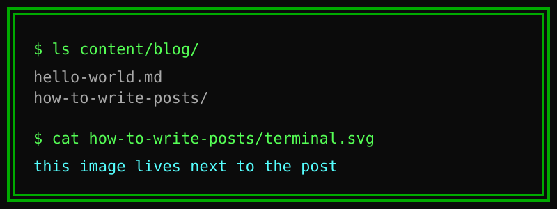

+++
title = "How to write a blog post"
date = 2026-10-23
description = "A quick tutorial: front matter, formatting, images, and code blocks."

[taxonomies]
tags = ["tutorial", "meta"]
+++

This post doubles as a cheat sheet. Open `content/blog/how-to-write-posts/index.md` next to this page to see how everything below is written. Delete it whenever you like.

<!-- more -->

## 1. Create a post

There are two ways to add a post inside `content/blog/`:

- **A single file**, like `my-post.md`. Simple, great for text-only posts.
- **A folder with an `index.md`**, like this post. Anything you drop in the folder (images, files) is served next to the post. Use this when you have images.

```text
content/blog/
├── hello-world.md
└── how-to-write-posts/
    ├── index.md
    └── terminal.svg
```

## 2. Front matter

Every post starts with a block between `+++` lines. It's TOML:

```toml
+++
title = "My post title"
date = 2026-10-23
description = "One line shown in lists and search results."
draft = false

[taxonomies]
tags = ["nix", "linux"]
+++
```

- `title` and `date` are required for the blog list to sort properly.
- `description` is optional but nice to have.
- `draft = true` hides the post from `zola build`, but `zola serve --drafts` still shows it.
- `tags` are clickable and appear on the `/tags/` page.

The line `<!-- more -->` after the intro marks the summary, in case a template shows excerpts.

## 3. Basic formatting

Posts are written in Markdown.

**Bold**, *italic*, ~~strikethrough~~, and `inline code` all work. Links look like [Zola's docs](https://www.getzola.org/documentation/), and you can link to other pages on your site with `@/`, like [the first post](@/blog/hello-world.md).

### Lists

1. Numbered lists
2. keep their order
   - and can nest
   - bullet lists inside

- [x] Task lists are supported too
- [ ] if you enable them in your theme

### Quotes and rules

> A quote looks like this. Great for callouts and notes.

---

### Tables

| Command        | What it does               |
| -------------- | -------------------------- |
| `nix develop`  | enter the dev shell        |
| `nix run`      | start the dev server       |
| `nix build`    | build the static site      |

## 4. Images

Put the image file in the post's folder and reference it by name:

```markdown

```


For a caption or a fixed size, use plain HTML:

```html
<figure>
  
  <figcaption>Figure 1: my terminal</figcaption>
</figure>
```

<figure>
  
  <figcaption>Figure 1: my terminal</figcaption>
</figure>

Images shared by several posts can live in `static/images/` and be used with an absolute path like `/images/photo.png`.

Always write alt text. It helps screen readers and shows up if the image fails to load.

## 5. Code blocks

Put the language name after the opening backticks to get syntax highlighting.

```rust
fn main() {
    let name = "world";
    println!("hello, {name}!");
}
```

```python
def greet(name: str) -> str:
    return f"hello, {name}!"

print(greet("world"))
```

```bash
# build the site and open the output folder
nix build && ls result/
```

```nix
{
  inputs.nixpkgs.url = "github:NixOS/nixpkgs/nixpkgs-unstable";
  outputs = { self, nixpkgs }: { };
}
```

```javascript
const greet = (name) => `hello, ${name}!`;
console.log(greet("world"));
```

For short snippets inside a sentence, use single backticks, like `git commit -m "fix"` or `services.openssh.enable = true;`.

If you don't want highlighting, use `text` as the language:

```text
plain output, no colors
```

## 6. Embedding raw HTML

Markdown allows raw HTML when you need it, for example a collapsible section:

<details>
<summary>Click to expand</summary>

Hidden content goes here. You can use **Markdown** inside.

</details>

## 7. Publish checklist

1. Write the post and set a real `date`.
2. Run `nix run` and check it at `http://127.0.0.1:1111`.
3. Make sure `draft` is not `true`.
4. Run `nix build` (or push, if you deploy from CI).

That's it. Happy writing!
